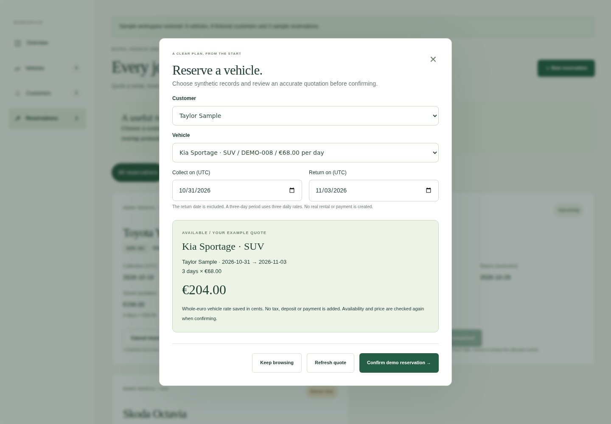

# Ben Janning — selected projects

**Data analytics · Software development · Practical business thinking**

## [Explore the visual portfolio →](https://benjanning.github.io/projects/)



[Try car records](https://benjanning.github.io/data-representation-project/) · [Try hotel booking](https://benjanning.github.io/cork-city-hotel/) · [Try the sorting explorer](https://benjanning.github.io/Sorting-Algorithms-Project/)

The two application demos run synthetic data in your browser. Flask, Express and MySQL implementations are available separately in their source repositories. No real reservation, payment or fleet availability is implied. Sorting animation explains operations; it does not measure Python runtime.

## Selected work

| Project | What to explore | Technologies |
| --- | --- | --- |
| [Fleetdesk rental management](https://benjanning.github.io/projects/projects/car-rental/) · [Source](https://github.com/benjanning/data-representation-project) | Quote a rental, allocate an available vehicle and manage demonstration reservations with tested date, pricing and concurrency rules. | Python, Flask, MySQL, JavaScript |
| [Breast cancer classification](https://benjanning.github.io/projects/projects/machine-learning/) · [Source](https://github.com/benjanning/pfda-Project2) | Explore saved classifier errors, compare a training-majority baseline and see why accuracy alone can mislead. | Python, pandas, scikit-learn, Seaborn |
| [Hotel booking prototype](https://benjanning.github.io/projects/projects/hotel-booking/) · [Source](https://github.com/benjanning/cork-city-hotel) | A polished multi-step hotel demonstration with exact pricing, stable confirmation retries and recoverable booking reviews. | Node.js, Express, EJS, MySQL |
| [Plant growth & statistics](https://benjanning.github.io/projects/projects/applied-statistics/) · [Source](https://github.com/benjanning/applied_statistics) | Explore every measurement, compare the size of group differences and keep statistical uncertainty visible. | Python, SciPy, pandas, JavaScript |
| [Sorting algorithms, measured](https://benjanning.github.io/projects/projects/sorting-algorithms/) · [Source](https://github.com/benjanning/Sorting-Algorithms-Project) | Compare sorting work on the same input, inspect each real trace and keep operation counts separate from measured runtimes. | Python, JavaScript, Algorithms, Benchmarking |
| [Iris dataset exploration](https://benjanning.github.io/projects/projects/iris-analysis/) · [Source](https://github.com/benjanning/pands-project) | Explore three Iris species through authentic measurements, clear distributions and reproducible descriptive analysis. | Python, pandas, NumPy, Seaborn |

Academic projects, carefully refined into demonstrable applications and reproducible investigations. Every case study identifies its exact verified source revision, genuine visuals, tests and practical limits. Original coursework and history remain available.

## How updates reach the website

Each source project's release workflow verifies its code and captures the interface or computes real charts. It exports metadata and image hashes identified by the source commit. Daily at 04:17 UTC, or on manual request, the central synchronizer checks the six registered public sources and proposes a review PR. A reviewer approves any held validation run, checks the evidence and merges the update. The central workflow generates the site, validates it and checks every page at desktop and mobile widths before deploying. It then verifies the actual public receipt, metadata, images and browser presentation.

Failed source tests or invalid metadata prevent an update from replacing the working site. The workflows never approve or merge their own PRs. No cross-repository write credential is required. See [publishing and troubleshooting](supporting-site-files/AUTOMATION.md).

## Preview and maintain

```bash
python supporting-site-files/build-site.py
python supporting-site-files/validate-site.py
python supporting-site-files/stage-site.py
python -m http.server 8080 --bind 127.0.0.1 --directory dist
```

Open http://127.0.0.1:8080. For the browser checks, use Node 22, `npm ci`, `npx playwright install chromium` and `npm run test:browser`. The site itself uses HTML, CSS and a small progressive-enhancement script, with no runtime framework, external fonts or analytics.

Edit source-owned `portfolio/project.json` and source scripts for project updates. Edit `build-site.py` for page design, and this README's [template](supporting-site-files/readme-template.md) for its introduction or instructions. Generated pages, image aliases and this overview are refreshed together; avoid editing generated HTML directly.

[V3 verification](supporting-site-files/V3-VALIDATION.md) · [Current source and image evidence](supporting-site-files/source-lock.json) · [Visual attribution](assets/PROVENANCE.md) · [Public repository directory](supporting-site-files/REPOSITORY-DIRECTORY.md) · [Historical V2 checks](supporting-site-files/V2-VALIDATION.md)
