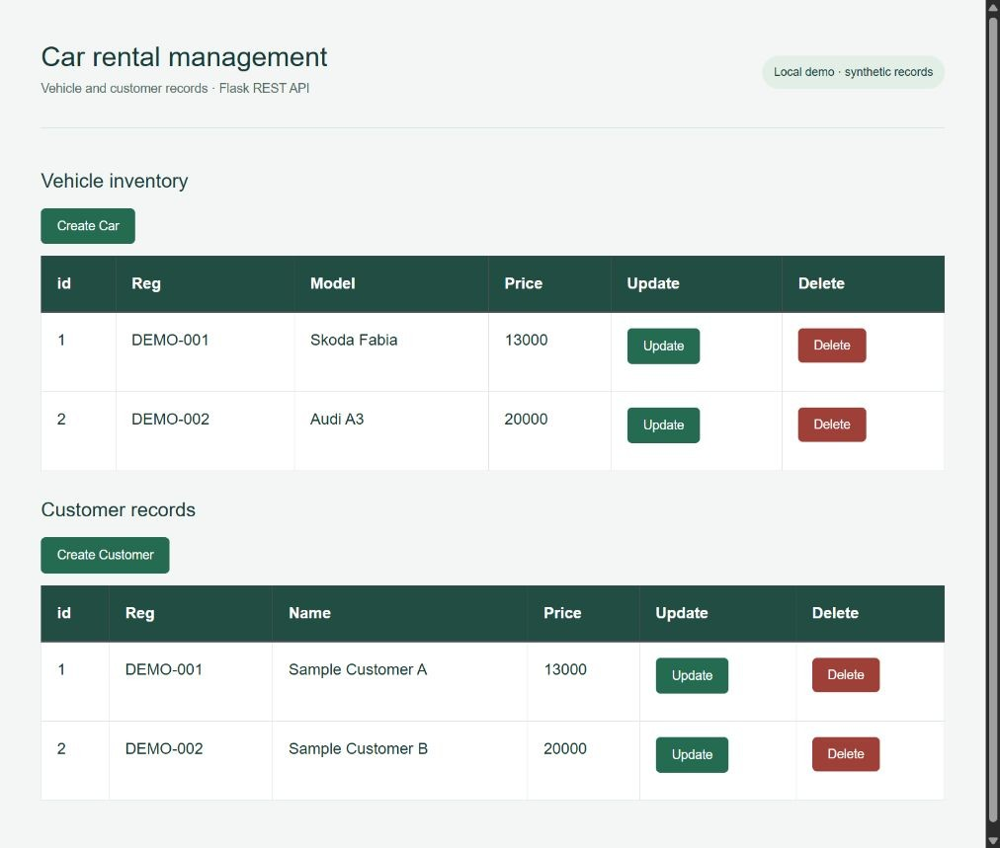

# Ben Janning — selected projects

**Data analytics · Software development · Practical business thinking**

I build tools that connect data and business requirements with useful technical solutions. This is the central guide to my selected public projects.

## [Explore the visual portfolio →](https://benjanning.github.io/projects/)

## Selected work

| Project | What it demonstrates | Technologies |
| --- | --- | --- |
| [Car rental management](https://benjanning.github.io/projects/projects/car-rental/) · [Source](https://github.com/benjanning/data-representation-project) | A browser interface and REST API for managing vehicle and customer records. | Python, Flask, MySQL, JavaScript |
| [Breast cancer classification](https://benjanning.github.io/projects/projects/machine-learning/) · [Source](https://github.com/benjanning/pfda-Project2) | Explore a public dataset, compare classifiers and examine the limits of model evaluation. | Python, pandas, scikit-learn, Seaborn |
| [Hotel booking prototype](https://benjanning.github.io/projects/projects/hotel-booking/) · [Source](https://github.com/benjanning/cork-city-hotel) | From dates and room selection to a server-calculated booking summary. | Node.js, Express, EJS, MySQL |
| [Plant growth & statistics](https://benjanning.github.io/projects/projects/applied-statistics/) · [Source](https://github.com/benjanning/applied_statistics) | Compare plant-growth treatments using visual exploration and statistical inference. | Python, SciPy, statsmodels, pandas |
| [Sorting algorithms, measured](https://benjanning.github.io/projects/projects/sorting-algorithms/) · [Source](https://github.com/benjanning/Sorting-Algorithms-Project) | Implement five sorting algorithms and compare them using verified, repeatable measurements. | Python, Algorithms, Benchmarking, Matplotlib |
| [Iris dataset exploration](https://benjanning.github.io/projects/projects/iris-analysis/) · [Source](https://github.com/benjanning/pands-project) | Use summary statistics and visual exploration to reveal patterns in the Iris dataset. | Python, pandas, NumPy, Seaborn |

## About the work

These are academic projects and learning investigations. The case studies distinguish original coursework from recent corrections, genuine application captures and newly generated charts. They explain what was tested and the limitations of each prototype.

## Website

Buildless HTML, CSS and a small progressive-enhancement script. Serve this directory using `python -m http.server 8080`, then open http://localhost:8080. All six case-study pages are static and use relative paths compatible with GitHub Pages project hosting. No external font, analytics, framework or build step is required.

Server applications run locally in their own repositories; GitHub Pages does not run Flask, Express or MySQL.

## Evidence and supporting material

- [Visual provenance and attribution](assets/PROVENANCE.md)
- [Repository audit and improvement record](supporting-site-files/REPOSITORY-AUDIT.md)
- [Validation record](supporting-site-files/VALIDATION.md)
- [Portfolio and LinkedIn copy](supporting-site-files/LINKEDIN.md)
- [Verified sorting measurements](assets/charts/verified_timings.csv)

Original project source and attribution remain in the linked repositories. Source history was preserved; no repository was deleted or made private/public as part of the reorganisation.
